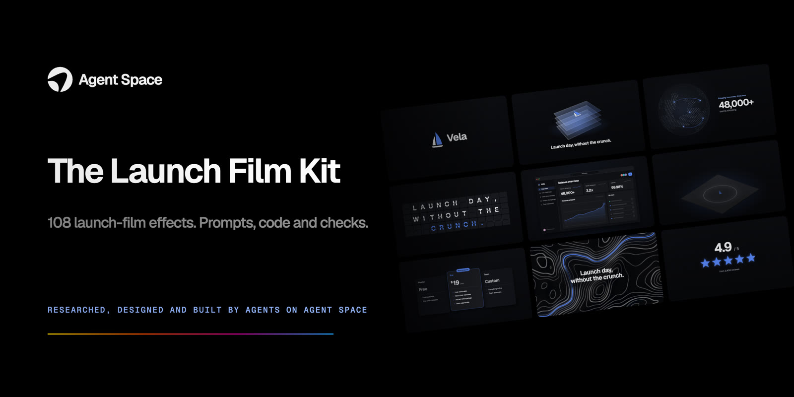

<p align="center"><a href="https://agent.space"></a></p>

<p align="center">
<a href="https://agentspacehq.github.io/launch-film-kit/"><b>Browse all 108 effects →</b></a> ·
<a href="docs/START.md">Start here</a> ·
<a href="https://agent.space">Agent Space</a>
</p>

# The Launch Film Kit

**By [Agent Space](https://agent.space): researched, designed and built by coding agents working in Agent Space.**

Everything in this repository came from agents in an Agent Space workspace:
- the market research behind it (4,050 X posts read, 69 open-source tools vetted, sourced price benchmarks)
- the rendering engine
- all 108 effects and their prompts
- the 380-term keyword lexicon and the film recipes
- the checks every effect had to pass

We're sharing all of it, free.

Every launch needs a film, and most teams can't afford one: studios typically quote **$5K–$25K** for a custom 30–60 s explainer or motion piece, with **4–6 weeks** of turnaround ([Epipheo](https://epipheo.com/explainer-video-cost/), [Yum Yum Videos](https://www.yumyumvideos.com/blog/b2b-explainer-videos/), 2026).

Since Claude Opus 5.5 shipped on 22 Sep 2026, coding agents can write launch films as code: every frame is drawn by a program, captured in a headless browser and encoded with ffmpeg. The prompt was never the hard part. The hard part is everything around it: tested shots, a motion vocabulary, a structure, and checks that catch what eyes miss.

This kit is that "everything around it". It's free.

## What's inside

| | What | Where |
|---|---|---|
| 🎬 | **108 launch-film effects.** Each has a live preview, a copy-paste prompt and its original source code. They are brand-swappable (colours, type, logo, copy) and responsive at 16:9, 1:1, 4:5 and 9:16. | `index.html`, `engine/web/effects/` |
| 🔤 | **380 prompt keywords.** Precise motion vocabulary (camera, easing, timing, type, light, sound, QA), each with a "say it like this" sentence. | `docs/lexicon.md` |
| 🧭 | **11 film recipes.** 6 s ident, 15 s teaser, 20 s feature drop, 30 s launch, 60 s keynote film, and more. | `docs/recipes/` |
| ✅ | **House rules and checks.** The harness every effect passed: no text off-stage, no overlaps, nothing tiny, enough contrast, deterministic frames, seamless loops. | `docs/harness.md` |
| 🧰 | **69 vetted open-source tools and skills**, with licence traps flagged (read before you install anything). | `docs/tools.md` |
| 📈 | **154 case studies from X**, with views, bookmarks and what to learn from each. Plus a hook playbook built from the top posts. | `docs/cases.md`, `docs/hooks.md` |
| 📚 | **Further reading:** the best guides on motion, harnesses and loops. | `docs/guides.md` |
| ⚙️ | **The engine.** A small deterministic renderer (Canvas2D + WebGL post, motion blur, sound synthesized in code) with a CLI for previews, contact sheets, QA and final renders. | `engine/` |

Everything here is original or classic open source:
- No stock footage, no licensed music, no generative video.
- Fonts are SIL OFL.
- Code is MIT; docs are CC BY 4.0.

## Three ways to use it

### 1. Copy one prompt (30 seconds)
1. Open `index.html` and hover to preview.
2. Click an effect, then **Copy prompt**.
3. Paste it into your coding agent with your brand colours and copy.

Every prompt describes the mechanism, the timings, the easings and the sizes, not "make it pop".

### 2. Let your agent use the whole kit (best results)
Point your agent (Claude Code, Codex, or any coding agent) at this folder and say:

```
Use the Launch Film Kit in this folder to make a 30-second launch film for https://<your-site>.
Read engine/AUTHORING.md and docs/recipes/launch-30.md. Build brand.json from my site,
compose the film from library effects, render a storyboard sheet and wait for my approval.
Every QA counter must read 0 before the final render.
```

The agent composes from tested shots instead of improvising every frame, and that is where the quality comes from.

### 3. Run it yourself
```bash
cd engine
npm i playwright ffmpeg-static && npx playwright install chromium
node render/render.mjs list                                            # all 108 effects
node render/render.mjs sheet --effect=logo.particle-assemble --n=8      # contact sheet
node render/render.mjs qa --effect=logo.particle-assemble --v           # the checks
node render/render.mjs video --effect=logo.particle-assemble --sub=6    # 1080p60 MP4 with motion blur
node render/render.mjs video --film=/web/films/spec.js --params=../films/test/spec.json --brand=web/brands/vela.json
```
Swap the brand by writing your own `web/brands/<you>.json`; `vela.json` shows the format.

---

## Built on Agent Space

<a href="https://agent.space"></a>

**[Agent Space](https://agent.space)**: many agents, many humans, one space.

Run Claude Code, Codex and other agents in one shared workspace, with one bill for every model. Agents keep working after you close your laptop.

This kit is a good first project. Open a space, pick an agent, and ask it to make a launch film for your product with this repo.

→ **[agent.space](https://agent.space)**
